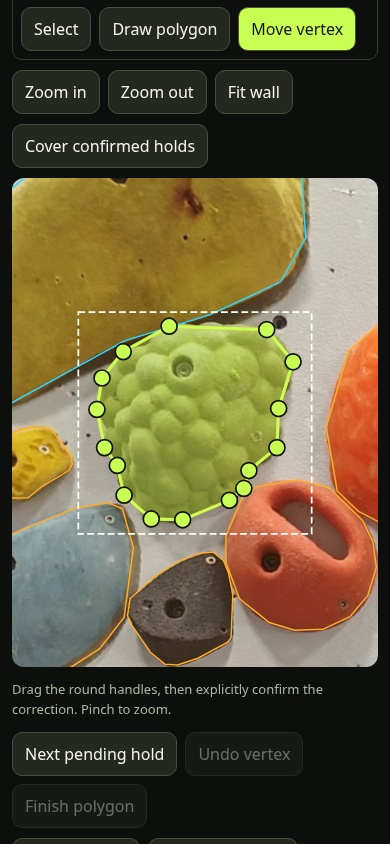

# Unified annotation and wall-update review

The existing editor at `/?annotate=1` now has two modes. **Manual annotation**
retains the original SAM2 server workflow. **Wall update review** (direct link:
`/?review=1`) loads an offline registered scan into that same canvas and editing
controls. The new workflow never writes production geometry or routes.



This is the first interactive slice of Phase C: manual review, correction and
checkpointing. Automatic change classification/proposal generation, team review,
accepted-geometry export, publication and version migration remain unimplemented.
All review checkpoints explicitly have `publishable: false`, even at zero pending.
A reviewer name is a local history label, not an authenticated approval identity.

## Browser-only / Vercel use

The built static application can run on Vercel without a Python server for
comparison, drawing, vertex correction and review. No new cloud service or
production deployment is needed to test it locally. Open Wall update review,
then select a scan folder or its individual files:

- `manifest.json`
- `holds_prelabels.json`
- `review_queue.json` (original pipeline revision 0)
- `report.json`
- `wall_registered.png` (full-resolution lossless Phase B candidate)
- `coverage.png`, `uncertainty.png`
- optional `source-index-preview.png`, `qa-overlay.jpg`
- optional `review-progress.json` (previously exported checkpoint)

Use the full local Phase B output, e.g.
`artifacts/wall-rescans/mosaic-fixture-v1/`. The compact audit files checked into
Git are deliberately insufficient to reopen the full-resolution editor. Phase A's
JPEG-only output is not yet supported by this importer. New raw captures must
still be registered/composed offline first; importing them here does not align
photographs automatically.

The candidate bytes, old reference bytes and old hold-map bytes are SHA-256
checked against the immutable scan identity. Dimensions alone are insufficient.
The current build supports the existing 7292×5514 reference/map. The map is fetched
as a lazily loaded asset; it does not enlarge the main route-setting bundle.
If the old image is not available from this app, include a hash-matching
`reference.jpg`. A different old hold map requires the matching reference build.

Image files remain local object URLs. No photos or review checkpoints are uploaded
by the browser-only mode. The old reference/map are fetched from the app. Opening
review checks the same-origin SAM2 status endpoint; absent service only disables
inference. Use HTTPS (localhost also works), a current browser with Web Crypto,
Web Locks and available localStorage. Large full-resolution images can be slow or
memory intensive on a phone. Folder selection varies by mobile browser; selecting
individual files is the fallback.

## Review workflow

1. Open **Session, reviewer & backups**, enter a reviewer name.
2. Use **Next unreviewed hold**, Select, or the entry dropdown. Selecting an entry
   zooms and scrolls to its outline. The next-entry controls prioritize sufficiently
   observed entries and cycle past the current selection; uncovered entries remain
   available in the dropdown for inspection.
3. Compare **New scan**, **Old wall**, or **Overlay** with adjustable opacity.
   Comparison mode disables edits/decisions; switch back to New scan to edit.
   QA overlays distinguish gaps (magenta), seams (yellow) and alignment risks
   (red); they are not detected hold changes. Photo-source/QA previews are linked.
4. **Confirm unchanged** preserves the old outline and ID. **Move vertex** drags
   handles; **Draw polygon** taps 3–16 vertices, then **Finish polygon**. Explicitly
   **Confirm corrected outline** saves a same-hold correction with its old ID.
   Adding points or changing a draft alone does not record a confirmation.
5. **Mark removed** records an inherited tombstone without deleting the old map.
   **Different / moved hold? → Confirm replacement with new ID** atomically removes
   the inherited identity and records a new hold with a fresh ID and lineage.
   Overlapping old and replacement geometry is allowed; it is not deduplicated
   against unreviewed/removed old outlines.
6. **New hold / Clear** followed by drawing or SAM2 creates a separate new hold.
   V5 review bundles also support an explicit score-threshold bulk confirmation
   of eligible SAM2 contours; see [v5 review controls](wall-v5-review-server.md#bulk-confirmation).
7. **Reset decision** returns inherited geometry to its original unreviewed state;
   a new hold becomes dismissed. For replacement reversal, reset/dismiss the new
   replacement first, then reset the old entry. This avoids two active identities
   accidentally representing the same replacement.
8. **Cover confirmed holds** shades only human-confirmed unchanged/refined/new
   entries using estimated nearby wall colors. Pending, removed and dismissed
   entries do not disappear into this coverage display.

Inherited gaps start unreviewed. The user can explicitly confirm or refine them
manually, including outlines in v1-filled areas. New/refined outlines retain
measured coverage and a manual partial-coverage reason when applicable; masks
remain unchanged. Removing/replacing old entries and batch confirmation retain
their existing coverage requirements. Coverage is measured against the loaded
mask (native-resolution local raster for ordinary holds; capped at 1024px for
unusually large regions). Approximate coverage is a
conservative editing aid, not a publication gate. Alignment uncertainty is visible
and must be inspected manually; this stage does not claim to resolve parallax.

## Persistence and export

Each decision saves a single session-bound working copy containing geometry,
statuses, reviewer/time, lineage and full before/after history under one increasing
`reviewRevision`. Same-origin tabs serialize saves with Web Locks and compare the
complete stored working copy; a stale tab is rejected. The draft remains on
screen on failure. Quota/storage errors are reported rather than claiming a save.

Reload, then reopen the same original scan to reattach image files and restore
browser progress. **Export progress** downloads `review-progress.json`; keep a
backup before closing a private browser or clearing site storage. Images are not
embedded in the checkpoint. **Resume progress** validates exact identity and
replays decisions from the immutable baseline. Changed status flags, conflicting
history, older revisions and another image/session are rejected. If the folder
has a checkpoint but this browser already has progress, reopen the original folder
and use Resume progress explicitly. Importing/reopening resets unfinished drafts.

Local browser storage is not a team synchronization service or durable remote
backup. A future accepted-export/publishing service must independently enforce
review and QA gates; checkpoints cannot be passed into the legacy accepted-hold
importer (they intentionally have no top-level `holds` array).

## Optional SAM2 service

The same Python annotation server supports an explicit read-only rescan session:

```sh
npm ci
npm run build
python tools/sam2_annotation_server.py \
  --rescan-session artifacts/wall-rescans/mosaic-fixture-v1 \
  --review-only --port 8790
```

Open `http://127.0.0.1:8790/?review=1`, then **Open local server scan**. This mode
needs only standard Python; it serves existing scan files without loading SAM2.
The legacy annotation storage is never seeded or written. For actual inference,
use the previously documented SAM2 environment/checkpoint and replace
`--review-only` with:

```sh
--checkpoint /path/to/sam2.1_hiera_small.pt
```

CUDA is checked first by the existing loader; CPU remains supported. A matching
rescan server loads the candidate PNG, not the production wall. Status and every
prediction bind the session ID and exact candidate SHA-256. A legacy server or
another scan cannot supply a prediction to this workspace. Exclusion masks and
partial coverage remain editor review aids; SAM2 output always needs inspection.

The service stays on loopback by default; use the existing private access-key
mechanism if exposing it through a private HTTPS proxy. In rescan mode legacy
accept/import/delete/dismiss endpoints and accepted-geometry reads are disabled.
The server exposes only an allowlisted set of hash-checked scan artifacts.
Cross-origin inference from a separately hosted Vercel page is not configured:
serve the built app and SAM2 on the same origin for now. Static-only Vercel review
works without inference; a hosted compute integration is separate work.

## Validation

```sh
npm test
npm run build
python scripts/test_annotation_data.py
.venv-rescan/bin/python -m unittest discover -s tests/wall_rescan -v
PLAYWRIGHT_MODULE_PATH=/path/to/playwright CHROMIUM_PATH=/path/to/chromium \
  APP_URL=http://127.0.0.1:8790 node scripts/wall-review-smoke.cjs
```

The mobile test uses isolated browser storage and the real Phase B fixture. It
checks import, confirmation, vertex refinement, replacement IDs, comparison locks,
confirmed-only coverage, checkpoint round-trip, reload, stale-tab rejection,
wrong-image rejection and browser-only drawing with all SAM2 endpoints unavailable.
It never modifies the scan or production files. Actual SAM2 inference needs the
model environment and checkpoint; it is not claimed by the review-only smoke test.

Validated implementation: frontend tests/build, 27 rescan Python tests and 5 legacy
annotation-data tests passed. The real-fixture mobile smoke passed with no page
errors, horizontal overflow or legacy annotation writes. The original manual
mode also retained its 677-hold load and display-only coverage toggle. This run
used the review-only server; no new SAM2 model inference was performed.
